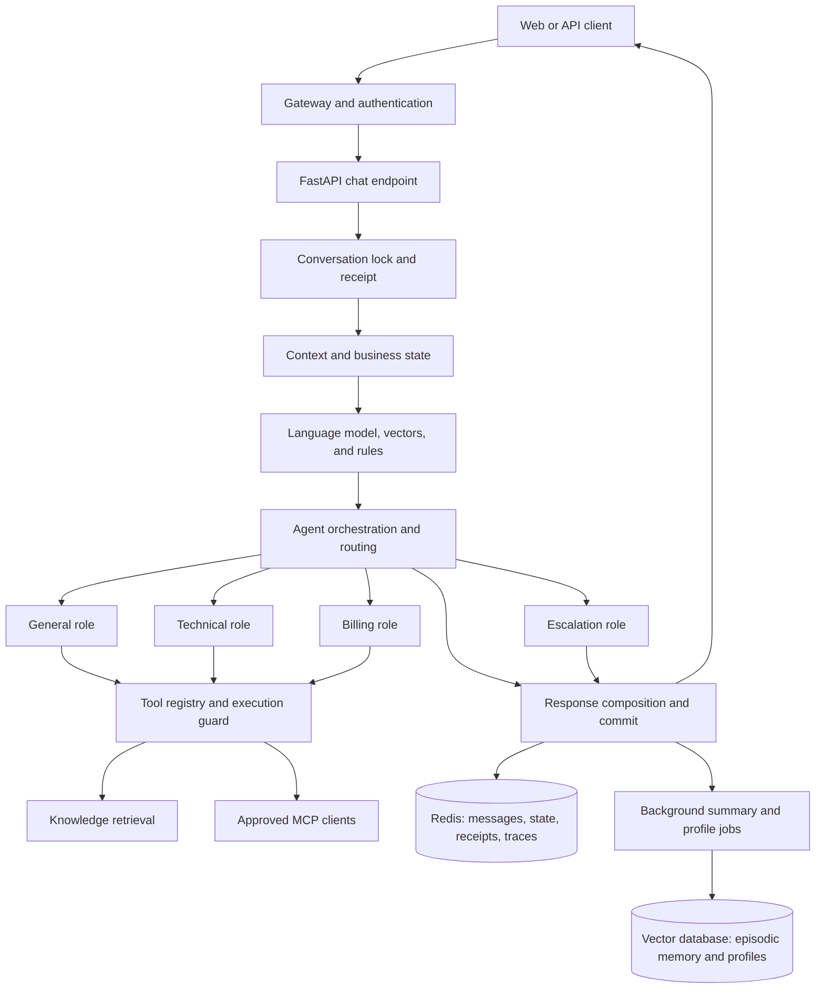

# AgentFlow Technical Design

> Version: 0.1 proposal | Updated: 2026-10-30 | See [product requirements](requirements.md).

## 1. Status and Technology Direction

The repository does not yet contain a product implementation. This document describes a proposed design. Start with a Python 3.12 service using FastAPI, Redis, and ChromaDB. Add a web console after the chat API contract is stable. Use a model provider that supports tool calling and a compatible messages API; select the provider, model, and budget for the deployment environment.

Treat initial weights, timeout values, and evaluation scores as tunable defaults. Make them observable and validate them with a project-specific labeled set and load profile before setting production targets.

## 2. Logical Architecture



Keep knowledge documents, episodic memory, and user profiles in separate collections. Redis stores recent messages, current summaries, structured state, request receipts, locks, and short-lived traces. Redis and the vector database do not share a transaction; log background persistence failures and provide a recovery path.

## 3. Component Responsibilities

| Component | Responsibility |
| --- | --- |
| API and access control | Validate requests, resolve bearer identity, protect administrator endpoints, and define response and error contracts. |
| Intent recognition | Fuse language-model, vector, and rule signals; return intent, domain, urgency, entities, confidence signals, and vector source. |
| Agent orchestration | Clarify ambiguous requests, route urgent requests, select primary and supporting roles, execute in parallel, compose answers, and apply fallback behavior. |
| Role tools | Provide deterministic context inspection, technical diagnostics, billing-field checks, amount comparison, and handoff summaries. |
| Tool guard and MCP | Enforce role allowlists and schemas; apply timeout, cache, and circuit-breaker policies; discover and filter external tools. |
| Knowledge retrieval | Import and chunk documents, track versions, retrieve passages, and optionally rewrite, deduplicate, and rerank queries. |
| Conversation memory | Maintain recent messages, summaries, profiles, inherited fields, locks, receipts, and atomic turn commits. |
| Operations | Reload Skills, publish metrics, store redacted traces, and run asynchronous evaluations with compatible regression baselines. |

## 4. Chat Turn Lifecycle

1. The client sends `POST /chat` with `message`, optional `conv_id`, and a stable `client_request_id` for safe retries. After authentication, the token identity overrides any user ID supplied in the body.
2. Acquire the conversation lock and check the receipt. Reusing an ID with different content returns a conflict. Return completed receipts directly; retry only failures explicitly marked retryable.
3. Read recent messages, summaries, relevant episodic memories, profile data, and structured business fields. Recognize intent using the current message and bounded history, then merge fields under rules for changed orders and domains.
4. Route urgent or explicit handoff requests first. Otherwise select one role or a primary and supporting roles. Ask for missing information when clarification is needed. A role may request knowledge or another approved tool only when needed.
5. Compose successful role results into one reply. Return `partial` when some roles fail but useful output remains; return `failed` when all roles fail. Record both execution status and business-result status for each tool call.
6. Atomically save the receipt and available trace in Redis. Save user and assistant messages plus business state for non-failed turns. Enqueue summary and profile maintenance after the response path.

Use an initial 50-second overall HTTP chat budget including lock wait, context loading, model calls, tools, and commit. Inner timeouts remain bounded by the overall budget. A client retry after timeout reuses the original `client_request_id`; a new message uses a new ID.

### Request example

```json
{
  "message": "Sign-in returns 401 and I may have been charged twice",
  "user_id": "demo-user",
  "conv_id": "demo-conversation",
  "client_request_id": "turn-001"
}
```

The response should include `conv_id`, `request_id`, `response`, `intent`, `intent_group`, `entities`, `primary_agent`, `supporting_agents`, `tools_used`, `status`, `retryable`, `error_code`, and `latency_ms`. `request_id` identifies an execution for trace lookup; `client_request_id` identifies a logical message for retry. They are not interchangeable. `status` is `success`, `partial`, or `failed`. Preserve HTTP status and application error code together. An escalation flag must not imply that a real support agent accepted the case.

## 5. Intent, Routing, and Tool Policy

### Intent and vectors

Start with configurable fusion weights such as 0.7 for language-model classification, 0.2 for vector matching, and 0.1 for rules. Aggregate domain scores before selecting a fine-grained intent within the domain. Validate the weights on labeled data before treating them as effective defaults.

An online embedding provider may be used for intent matching, with local character n-gram vectors as fallback. On fallback, switch both the query vector and template vectors together. Intent vectors and knowledge-retrieval vectors serve different purposes and must not be compared across embedding spaces.

### Roles and routing

The General role handles broad questions and missing fields. Technical provides error-code explanations and low-risk diagnostic steps. Billing checks required fields and performs arithmetic on user-provided amounts. Escalation creates a deterministic handoff summary. Configure each role's prompt, tool allowlist, and output limits independently.

Primary and supporting roles may run concurrently. If composition fails, preserve useful primary output with a clear partial status. A specialist failure may fall back to General, except after a side-effecting tool has been attempted; that operation must not be repeated automatically.

### Tool execution boundaries

The model may request a tool, but application code checks its role allowlist and JSON Schema before execution. Read-only tools may use timeouts, caching, and circuit breakers. A failed retrieval must never be presented as a retrieved policy. MCP configuration must specify the server, allowed tools, eligible roles, and read-only restrictions. Send only the parameters required by the selected external tool; do not include full history or profile data by default.

Before adding refund or other write tools, persist a non-replayable pre-operation receipt. The downstream system must enforce identity, business authorization, and idempotency keys and provide operation-status lookup. A local receipt alone cannot establish the outcome of a downstream operation.

## 6. Data and Persistence

| Data | Suggested store | Lifetime and consistency |
| --- | --- | --- |
| Recent messages, current summary, business state | Redis | Start with a 24-hour TTL; serialize reads and commits per conversation. |
| Client message receipts | Redis | Start with a 24-hour TTL; identical retries return the saved result, changed content conflicts. |
| Tool traces | Redis | Start with a 7-day TTL and a recent index capped at 200 entries; redact sensitive inputs and errors. |
| Knowledge chunks | Vector database collection `knowledge_base` | Identify by `document_id` or title; store content version and chunk index; remove stale chunks and invalidate retrieval caches on update. |
| Episodic memory and profiles | Separate vector database collections | Scope queries by user; write asynchronously and preserve existing data if generation fails. |
| Evaluation jobs | Bounded in-process queue initially | Start with at most 8 unfinished jobs and retain up to 50 results; process restart loses job state. Use a durable queue if that is unacceptable. |

Support `.txt`, `.md`, and `.json` knowledge uploads, with an initial size limit of 10 MB. A 500-character chunk window is a reasonable starting point. Preserve title, document identity, version, and chunk index in retrieval results. Development may use a local vector database; production connection failure must be explicit and must not silently fork writes into a different store.

## 7. API Outline

These paths form a starting contract. Publish the final schema through OpenAPI before client integration.

| Method and path | Purpose | Phase |
| --- | --- | --- |
| `GET /health` | Application readiness; does not prove model credentials work. | P0 |
| `POST /chat` | Chat, routing, receipts, and state commit. | P0 |
| `POST /search` | Retrieval diagnostics with `query` and `top_k` query parameters. | P0 |
| `POST /knowledge/add`, `POST /knowledge/upload`, `GET /knowledge/stats` | Import, upload, and count knowledge chunks. | P0 |
| `GET /skills`, `POST /skills/reload` | Inspect and reload business rules. | P1 |
| `GET /trace/tool/{request_id}`, `GET /trace/tools` | Inspect a single or recent redacted trace. | P1 |
| `GET /monitor`, `GET /metrics` | Runtime summary and Prometheus metrics. | P1 |
| `POST /eval/run`, `GET /eval/jobs/{job_id}` | Submit an asynchronous evaluation and poll its result. | P1 |
| `GET /integrations/embedding`, `POST /integrations/embedding/check` | Inspect the actual intent-vector provider. | P1 |
| `GET /integrations/mcp`, `POST /integrations/mcp/call`, `/mcp/` | Inspect external MCP connections, debug approved tools, and serve local MCP tools. | P1 |

Distinguish at least these failures: 401 unauthenticated, 403 forbidden, 409 message-ID conflict, 422 invalid request, 503 service or execution failure, 504 chat timeout, and 429 when the evaluation queue is full. Clients must not assume every non-2xx response has the normal chat response shape.

## 8. Deployment and Security

Deploy the API with Redis, a vector database, Prometheus, and a reverse proxy. Serve the web console through a development server locally or as static assets behind the proxy. Containers should use service names for Redis and the vector database. Keep model and MCP credentials in server-side environment variables or a secret store; never expose them through public frontend variables.

Production requires bearer authentication and separate customer and administrator roles. Protect knowledge writes, Skills reload, evaluations, trace access, monitoring, and integration diagnostics as administrative operations. Persist Redis, vector database, and monitoring data in explicit volumes; mount Skills, evaluation baselines, and logs separately. Document backup and restore boundaries: in-process jobs and caches do not survive a process restart. Never seed demonstration knowledge in production.

## 9. Verification Plan and Requirement Mapping

The following checks are planned for implementation; they are not product tests already present in this repository. Unit tests should cover intent voting, state inheritance, routing, tool permissions, and document chunking. Integration tests should cover Redis receipts and locks, knowledge updates, and MCP allowlists. Contract tests should cover API status codes and frontend response adaptation. End-to-end evaluation should cover multi-turn context, mixed intents, timeouts, retries, and production authentication. Use an independent labeled set to measure model quality.

| Requirement | Main component | Key verification |
| --- | --- | --- |
| FR-01 | API and response models | New conversation and continuation contracts |
| FR-02 | Intent recognizer | Signal fusion and vector fallback |
| FR-03 | Orchestrator and response composer | Primary/supporting routing and escalation |
| FR-04 | Role tools and execution guard | Permission and schema rejection |
| FR-05 | Knowledge store and retrieval tools | Reimport and source traceability |
| FR-06 | Memory and business state | Field inheritance and clearing |
| FR-07 | Conversation locks, receipts, and commits | Concurrency, conflict, and retry |
| FR-08 | Escalation role | Handoff wording without fictitious tickets |
| FR-09 | Skills manager | Matching, reload, and error reporting |
| FR-10 | Evaluation service | Job progress, scoring errors, and regression checks |
| FR-11 | Monitoring and traces | Redaction, routing penalties, and recovery |
| FR-12 | Web console and API client | Backend switching and stale-response isolation |
| FR-13 | MCP client and server | Allowlist, read-only behavior, and minimal parameters |

## 10. Open Decisions

Before production, choose the target industry and knowledge content, model provider, deployment environment, identity provider, data-retention policy, measurable quality targets, and whether ticketing or payment systems must be integrated. These decisions affect model cost, permissions, data handling, and acceptance criteria.
