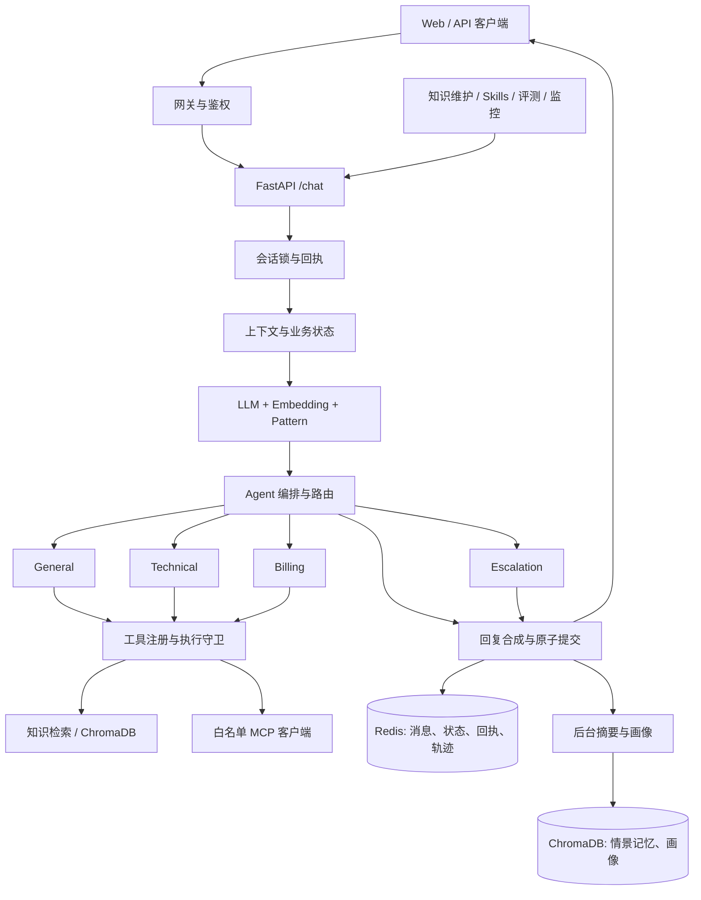

# AgentFlow 技术文档

> 版本：0.1（技术方案草案）｜整理日期：2026-10-30｜对应 [需求文档](requirements.md)

## 1. 状态与技术取舍

AgentFlow 仓库目前只有项目规则与文档测试，下文描述拟建设计。参考实现为 EchoMind 的 Python FastAPI 后端；其 Java 服务用作能力对照，Vue 前端用作交互参考。首期建议以 Python 3.12、FastAPI、Redis、ChromaDB 为主链路，Web 界面在核心 API 稳定后接入。模型调用使用支持 Anthropic Messages 和工具调用的服务，具体提供商、模型及费用由部署环境决定。

设计取舍来自源代码现状，不应直接将源项目的固定权重、超时和模型名视为 AgentFlow 已验证参数。先保留可配置和可观测性，再用自己的标注集与负载数据调优。

## 2. 逻辑架构



知识库、情景记忆和用户画像在 ChromaDB 使用不同集合。Redis 持有近期消息、当前摘要、结构化状态、请求回执、锁和短期轨迹。两种存储之间没有跨库事务，后台长期记忆失败需记录并允许补偿。

## 3. 核心模块职责

| 模块 | 职责 | 参考源码 |
| --- | --- | --- |
| API 与访问控制 | 校验请求、Bearer 身份、管理员接口、状态码和响应契约。 | `EchoMind/api/main.py`、`core/access.py` |
| 意图识别 | LLM、向量、规则融合；输出细分意图、领域、紧急度、实体、来源。 | `core/intent_recognizer.py`、`core/intent_embedding.py` |
| Agent 编排 | 澄清、升级、主辅路由、并行执行、合成与兜底。 | `agents/agent_orchestrator.py` |
| 角色工具 | 通用上下文、技术排障、账单字段检查、金额比较、人工交接。 | `agents/tools.py` |
| 工具守卫与 MCP | 角色白名单、参数 Schema、超时、缓存、熔断、外部工具发现和只读筛选。 | `tooling/tool_manager.py`、`tooling/mcp_client.py`、`tooling/mcp_server.py` |
| 知识检索 | 导入切片、文档版本、向量检索、改写、去重与重排。 | `tooling/knowledge_base.py`、`tooling/tool_manager.py` |
| 会话记忆 | 近期消息、摘要、画像、字段继承、会话锁、回执和原子提交。 | `memory/conversation_memory.py`、`core/conversation_state.py` |
| 运营能力 | Skills 热加载、监控指标、脱敏轨迹、异步评测和回归基线。 | `core/skill_loader.py`、`monitor/`、`evaluation/` |

## 4. 一轮对话的数据流

1. 客户端提交 `POST /chat`，传入 `message`、可选 `conv_id`，以及用于安全重试的 `client_request_id`。认证后用户身份以 Token 映射为准。
2. 服务取得同会话锁并检查回执。同 ID、不同消息返回冲突；已完成回执直接返回；可重试失败才重新处理。
3. 读取近期消息、摘要、相关情景记忆、画像与结构化业务字段。意图识别使用当前消息和有限历史；业务字段按新旧实体及领域切换规则合并。
4. 路由先处理紧急升级和人工诉求，再决定单角色或主辅协作。需澄清时直接问缺失信息。普通角色根据职责调用获准工具，RAG 仅在 Agent 需要资料时触发。
5. 多角色成功结果合成为一条回复；部分角色失败可返回 `partial`，全部失败返回 `failed`。工具轨迹记录执行成功与业务结果成功，两者分别判断。
6. Redis 中原子保存响应回执和可用轨迹；非失败轮次同时保存用户消息、助手消息和业务状态。返回后才提交后台摘要和画像任务。

参考实现给整轮 HTTP 聊天 50 秒预算，包含锁等待、上下文、模型、工具和提交。内层超时仍受总预算约束。客户端超时后复用原 `client_request_id`；新消息必须使用新 ID。

### 请求与响应示例

```json
{
  "message": "登录提示 401，而且订单可能重复扣款",
  "user_id": "demo_user",
  "conv_id": "demo-conversation",
  "client_request_id": "turn-001"
}
```

响应至少包含 `conv_id`、`request_id`、`response`、`intent`、`intent_group`、`entities`、`primary_agent`、`supporting_agents`、`tools_used`、`status`、`retryable`、`error_code` 和 `latency_ms`。`request_id` 查询轨迹，`client_request_id` 识别逻辑消息，二者用途不同。`status` 取 `success`、`partial`、`failed`；失败的 HTTP 状态与业务错误码需同时保留。不要把 `escalated=true` 解释为真实坐席已经接单。

## 5. 意图、路由与工具策略

### 意图与向量

EchoMind 的起始融合权重为 LLM 0.7、向量 0.2、规则 0.1；先聚合业务领域，再选领域内细分意图。AgentFlow 可从此起步，但须在标注集上验证。向量分支可选择在线 `BAAI/bge-m3`，失败时问题与模板一起退回本地 n-gram；知识库向量与意图向量是两套用途，不共用模型空间。

### 路由与角色

General 负责通用咨询与补字段，Technical 负责错误码和排障计划，Billing 负责账单字段及金额核算，Escalation 生成确定性交接摘要。角色提示、可用工具和输出限制分别配置。主辅 Agent 可并行执行，合成失败时保留可用主回复；专业角色故障可回退 General，但尝试过有副作用的工具后禁止自动重做。

### 工具执行边界

模型只能请求工具，程序根据角色范围和 JSON Schema 决定能否执行。只读工具可配置超时、缓存与熔断；失败结果不能被当作已检索到的政策。MCP 连接必须声明服务、允许工具、角色范围和只读限制。外部服务只收到该工具所需参数，不默认发送完整历史或画像。

未来接入退款等写操作前，先持久化不可自动重放的操作前回执。下游系统还需校验身份、业务授权和幂等键，并提供结果查询；仅有本服务回执不足以证明下游操作结果。

## 6. 数据与持久化

| 数据 | 建议存储 | 生命周期与一致性 |
| --- | --- | --- |
| 近期消息、当前摘要、业务状态 | Redis | 参考实现为 24 小时 TTL；同会话锁保护读、改、提交。 |
| 客户端消息回执 | Redis | 参考实现为 24 小时 TTL；相同 ID 返回原结果，消息不同时冲突。 |
| 工具轨迹 | Redis | 参考实现保留 7 天及最近 200 条索引；输入和错误信息脱敏。 |
| 知识文档片段 | ChromaDB `knowledge_base` | 按 `document_id` 或标题确定身份，记录内容版本和片段序号；更新时清理旧片段与缓存。 |
| 情景记忆和画像 | ChromaDB 独立集合 | 按用户隔离；后台生成，失败保留已有数据。 |
| 评测任务 | 首期进程内有界队列 | 参考实现为最多 8 个待处理、最近 50 个保留；重启丢失任务状态，需要持久任务时改用独立队列。 |

知识上传支持 `.txt`、`.md`、`.json`，参考大小上限 10 MB。知识库切片参考 500 字符窗口，查询返回可追溯元数据。开发环境可用本地 ChromaDB 降级；生产环境连接失败应启动失败或返回明确错误，避免写入另一套无声分叉的数据。

## 7. API 草案

路径与字段参考 Python 实现，正式开发时以 OpenAPI 契约为准。

| 方法与路径 | 用途 | 首期 |
| --- | --- | --- |
| `GET /health` | 初始化状态；不代表模型凭据可用。 | P0 |
| `POST /chat` | 对话、路由、回执与状态提交。 | P0 |
| `POST /search` | 独立检索调试，`query` 和 `top_k` 走查询参数。 | P0 |
| `POST /knowledge/add`、`POST /knowledge/upload`、`GET /knowledge/stats` | 文档导入、上传和片段统计。 | P0 |
| `GET /skills`、`POST /skills/reload` | 规则状态与热加载。 | P1 |
| `GET /trace/tool/{request_id}`、`GET /trace/tools` | 单次及近期脱敏轨迹。 | P1 |
| `GET /monitor`、`GET /metrics` | 运行摘要与 Prometheus 指标。 | P1 |
| `POST /eval/run`、`GET /eval/jobs/{job_id}` | 202 异步任务与结果轮询。 | P1 |
| `GET /integrations/embedding`、`POST /integrations/embedding/check` | 检查意图向量实际来源。 | P1 |
| `GET /integrations/mcp`、`POST /integrations/mcp/call`、`/mcp/` | 外部连接调试与本地 MCP 服务。 | P1 |

错误处理至少区分 401 未认证、403 权限不足、409 消息 ID 冲突、422 请求无效、503 服务或执行失败、504 聊天超时，以及评测队列满时的 429。前端不能假设所有非 2xx 响应都有聊天响应结构。

## 8. 部署与安全

参考部署为 FastAPI + Redis + ChromaDB + Prometheus + Nginx，前端可由 Vite 开发服务器或 Nginx 静态资源提供。容器内用服务名访问 Redis 和 ChromaDB，模型和 MCP 凭据仅在服务端环境变量或私密配置中。生产模式要求访问 Token，并区分用户与管理员；管理接口包括知识写入、规则重载、评测、轨迹与集成调试。

数据卷保存 Redis、ChromaDB 与监控数据；Skills、评测基线和日志单独挂载。部署前明确备份和恢复范围：进程内任务与缓存不会因卷持久化而恢复。开发示例知识不得自动导入生产。

## 9. 验证计划与需求映射

此处是未来实现的测试范围，非当前仓库已有的功能测试。单元测试覆盖意图投票、字段继承、路由、工具权限和文档切片；集成测试覆盖 Redis 回执与锁、知识更新、MCP 白名单；契约测试覆盖 API 状态码和前端响应适配；端到端评测覆盖多轮、复合诉求、超时、重试和生产鉴权。模型效果需使用独立标注集，避免只用演示样本判断准确率。

| 需求 | 主要实现位置 | 关键验证 |
| --- | --- | --- |
| FR-01 | API、响应模型 | 新会话与续聊契约 |
| FR-02 | 意图识别器 | 三路融合与向量降级 |
| FR-03 | 编排器、回复合成 | 主辅路由与升级 |
| FR-04 | 角色工具、执行守卫 | 权限和参数拒绝 |
| FR-05 | 知识库、RAG 工具 | 重导入与来源追溯 |
| FR-06 | 记忆、业务状态 | 字段继承与清理 |
| FR-07 | 会话锁、回执、提交 | 并发、冲突与重试 |
| FR-08 | Escalation | 交接说明无虚构工单 |
| FR-09 | Skill 管理器 | 匹配、重载和错误显示 |
| FR-10 | 评测服务 | 任务进度、错误与回归 |
| FR-11 | 监控、轨迹 | 脱敏、降权和恢复 |
| FR-12 | Vue 界面、API 客户端 | 页面切换与状态隔离 |
| FR-13 | MCP 客户端与服务端 | 白名单、只读和必要参数 |

## 10. 来源与待决策项

主要依据：本地 `EchoMind/README.md`、`api/main.py`、`core/access.py`、`core/intent_recognizer.py`、`agents/agent_orchestrator.py`、`agents/tools.py`、`memory/conversation_memory.py`、`tooling/knowledge_base.py`、`tooling/mcp_client.py`、`tooling/mcp_server.py`、`evaluation/jobs.py`、`EchoMindFrontend/src/lib/backends.js` 和 `EchoMindJava/README.md`。其中 Python 为行为基线，Java 的独立实现不自动视作 Python 已有能力。

正式开工前需确定：目标行业与知识内容、模型提供商、部署环境、身份系统、数据保留策略、可接受的效果指标，以及是否需要真实工单或支付系统集成。这些选择会改变模型成本、权限设计和验收基线。
