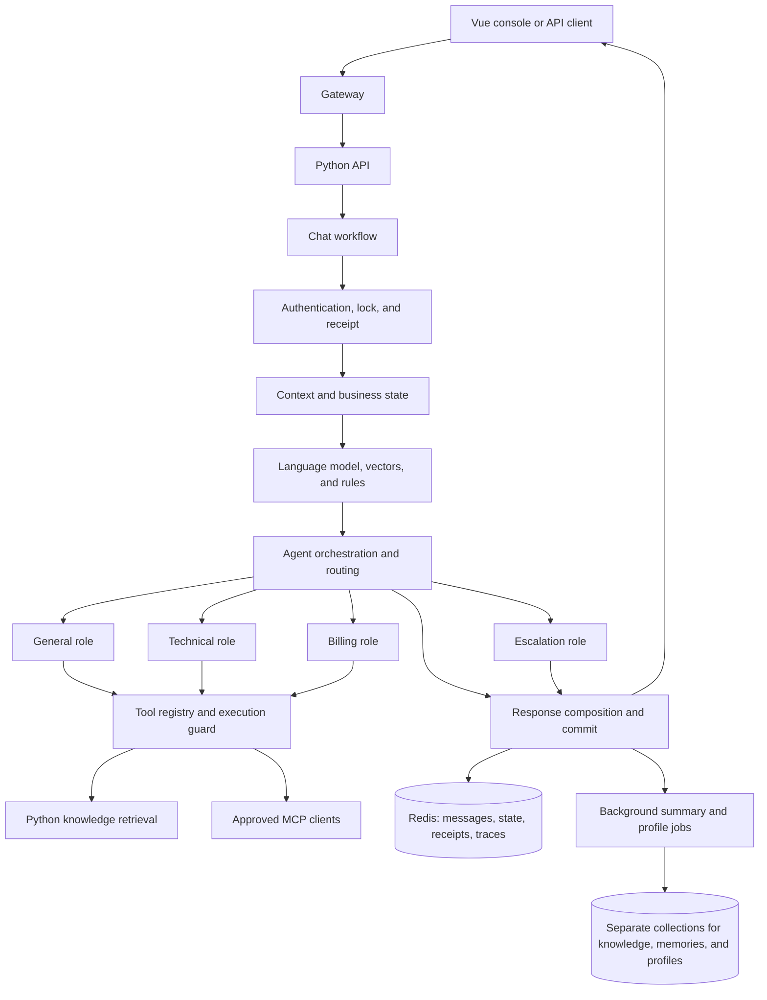

# AgentFlow Technical Design

> Version: 0.4 implementation blueprint | Updated: 2026-10-30 | See [product requirements](requirements.md) and [implementation status](implementation-status.md).

## 1. Status and Technology Direction

The repository contains a Python 3.12/FastAPI runtime, a Vue/Vite web console, and a Compose deployment for Stages 0–8. See the implementation status for verified coverage and outstanding work. Use a model provider that supports tool calling and a compatible messages API; select the provider, model, and budget for the deployment environment.

Treat initial weights, timeout values, and evaluation scores as tunable defaults. Make them observable and validate them with a project-specific labeled set and load profile before setting production targets.

## 2. Logical Architecture



Keep knowledge documents, episodic memory, and user profiles in separate vector collections. Redis stores recent messages, current summaries, structured state, request receipts, locks, and short-lived traces. Redis and the vector database do not share a transaction; log background persistence failures and provide a recovery path.

The Python package separates intent and Skills in `core/`, role orchestration and advisory handlers in `agents/`, retrieval and guarded tool execution in `mcp/`, conversation and long-term storage in `memory/`, evaluation in `evaluation/`, and HTTP wiring in `api/`. `mcp/knowledge_base.py` owns Chroma import and vector search; `mcp/retrieval.py` owns query rewriting and reranking. `mcp/tool_manager.py` owns tool registration, schemas, caching, timeouts, and circuit breaking; `mcp/client.py` and `mcp/server.py` adapt the external and local MCP protocols. Role fallback remains in `agents/agent_orchestrator.py` because it is a routing decision.

## 3. Component Responsibilities

| Component | Module | Responsibility |
| --- | --- | --- |
| API and access control | `api/app.py`, `api/auth.py`, `api/contracts.py` | Validate requests, resolve bearer identity, protect administrator endpoints, and define response and error contracts. |
| Web console | `web/src/` | Provide chat, knowledge, Skills, evaluation, connection settings, and request inspection for the Python API. |
| Intent recognition | `core/intent_recognizer.py`, `core/embedding.py`, `core/state.py` | Fuse language-model, vector, and rule signals; return intent, urgency, entities, confidence signals, and vector source. |
| Agent orchestration | `agents/agent_orchestrator.py` | Route urgent requests, select primary and supporting roles, execute in parallel, compose answers, and apply fallback behavior. |
| Role tools | `agents/tools.py` | Provide deterministic context inspection, technical diagnostics, billing-field checks, amount comparison, and handoff summaries. |
| Tool execution and MCP | `mcp/tool_manager.py`, `mcp/client.py`, `mcp/server.py` | Enforce role allowlists and schemas; apply timeout, cache, and circuit-breaker policies; discover and filter external tools. |
| Knowledge retrieval | `mcp/knowledge_base.py`, `mcp/retrieval.py` | Import and chunk documents, track versions, retrieve passages, and optionally rewrite, deduplicate, and rerank queries. |
| Skills | `core/skill_loader.py` | Load and filter guidance by role and keywords for inclusion in role prompts. |
| Conversation memory | `memory/conversation_memory.py`, `memory/long_term.py` | Maintain recent messages, summaries, profiles, inherited fields, locks, receipts, and atomic turn commits. |
| Evaluation | `evaluation/evaluator.py` | Score intent, dialogue, and retrieval suites with compatible regression baselines. |
| Operations | `core/operations.py` | Publish metrics, retain redacted traces, and monitor specialist recovery. |

## 4. Chat Turn Lifecycle

1. The client sends `POST /chat` with `message`, optional `conv_id`, and a stable `client_request_id` for safe retries. After authentication, the token identity overrides any user ID supplied in the body.
2. Acquire the conversation lock and check the receipt. Reusing an ID with different content returns a conflict. Return completed receipts directly; retry only failures explicitly marked retryable.
3. Read recent messages, summaries, relevant episodic memories, profile data, and structured business fields. Recognize intent using the current message and bounded history, then merge fields under rules for changed orders and domains.
4. Route urgent or explicit handoff requests first. Otherwise select one role or a primary and supporting roles. Ask for missing information when clarification is needed. Eligible business intents may request knowledge or another approved tool when needed; greeting, feedback, handoff, and unknown intent skip knowledge retrieval.
5. Compose successful role results into one reply. Return `partial` when some roles fail but useful output remains; return `failed` when all roles fail. Record both execution status and business-result status for each tool call.
6. Atomically save the receipt and available trace in Redis. Save user and assistant messages plus business state for non-failed turns. Enqueue summary and profile maintenance after the response path.

Use an initial 50-second overall HTTP chat budget including lock wait, context loading, model calls, tools, and commit. Inner timeouts remain bounded by the overall budget. A client retry after timeout reuses the original `client_request_id`; a new message uses a new ID.

### Request example

```json
{
  "message": "Sign-in returns 401 and I may have been charged twice",
  "user_id": "demo-user",
  "conv_id": "demo-conversation",
  "client_request_id": "turn-001"
}
```

The response should include `conv_id`, `request_id`, `response`, `intent`, `intent_group`, `entities`, `primary_agent`, `supporting_agents`, `tools_used`, `status`, `retryable`, `error_code`, and `latency_ms`. `request_id` identifies an execution for trace lookup; `client_request_id` identifies a logical message for retry. They are not interchangeable. `status` is `success`, `partial`, or `failed`. Preserve HTTP status and application error code together. An escalation flag must not imply that a real support agent accepted the case.

## 5. Intent, Routing, and Tool Policy

### Intent and vectors

Start with configurable fusion weights such as 0.7 for language-model classification, 0.2 for vector matching, and 0.1 for rules. Aggregate domain scores before selecting a fine-grained intent within the domain. Validate the weights on labeled data before treating them as effective defaults.

An online embedding provider may be used for intent matching, with local character n-gram vectors as fallback. On fallback, switch both the query vector and template vectors together. Intent vectors and knowledge-retrieval vectors serve different purposes and must not be compared across embedding spaces.

### Roles and routing

The General role handles broad questions and missing fields. Technical provides error-code explanations and low-risk diagnostic steps. Billing checks required fields and performs arithmetic on user-provided amounts. Escalation creates a deterministic handoff summary. Configure each role's prompt, tool allowlist, and output limits independently.

Primary and supporting roles may run concurrently. If composition fails, preserve useful primary output with a clear partial status. A specialist failure may fall back to General, except after a side-effecting tool has been attempted; that operation must not be repeated automatically.

### Tool execution boundaries

The model may request a tool, but application code checks its role allowlist and JSON Schema before execution. Read-only tools may use timeouts, caching, and circuit breakers. A failed retrieval must never be presented as a retrieved policy. MCP configuration must specify the server, allowed tools, eligible roles, and read-only restrictions. Send only the parameters required by the selected external tool; do not include full history or profile data by default.

Before adding refund or other write tools, persist a non-replayable pre-operation receipt. The downstream system must enforce identity, business authorization, and idempotency keys and provide operation-status lookup. A local receipt alone cannot establish the outcome of a downstream operation.

## 6. Data and Persistence

| Data | Suggested store | Lifetime and consistency |
| --- | --- | --- |
| Recent messages, current summary, business state | Redis | Start with a 24-hour TTL; serialize reads and commits per conversation. |
| Client message receipts | Redis | Start with a 24-hour TTL; identical retries return the saved result, changed content conflicts. |
| Tool traces | Redis | Start with a 7-day TTL and a recent index capped at 200 entries; redact sensitive inputs and errors. |
| Knowledge chunks | Vector database collection `knowledge_base` | Identify by `document_id` or title; store content version and chunk index; remove stale chunks and invalidate retrieval caches on update. |
| Episodic memory and profiles | Separate vector database collections | Scope queries by user; write asynchronously and preserve existing data if generation fails. |
| Evaluation jobs | Bounded in-process queue initially | Start with at most 8 unfinished jobs and retain up to 50 results; process restart loses job state. Use a durable queue if that is unacceptable. |

Support `.txt`, `.md`, and `.json` knowledge uploads, with an initial size limit of 10 MB. A 500-character chunk window is a reasonable starting point. Preserve title, document identity, version, and chunk index in retrieval results. Development may use a local vector database; production connection failure must be explicit and must not silently fork writes into a different store.

## 7. API Outline

These paths form a starting contract. Publish the final schema through OpenAPI before client integration.

| Method and path | Purpose | Phase |
| --- | --- | --- |
| `GET /health` | Application readiness; does not prove model credentials work. | P0 |
| `POST /chat` | Chat, routing, receipts, and state commit. | P0 |
| `POST /search` | Retrieval diagnostics with `query` and `top_k` query parameters. | P0 |
| `POST /knowledge/add`, `POST /knowledge/upload`, `GET /knowledge/stats` | Import, upload, and count knowledge chunks. | P0 |
| `GET /skills`, `POST /skills/reload` | Inspect and reload business rules. | P1 |
| `GET /trace/tool/{request_id}`, `GET /trace/tools` | Inspect a single or recent redacted trace. | P1 |
| `GET /monitor`, `GET /metrics` | Runtime summary and Prometheus metrics. | P1 |
| `POST /eval/run`, `GET /eval/jobs/{job_id}` | Submit an asynchronous evaluation and poll its result. | P1 |
| `GET /integrations/embedding`, `POST /integrations/embedding/check` | Inspect the actual intent-vector provider. | P1 |
| `GET /integrations/mcp`, `POST /integrations/mcp/call`, `/mcp/` | Inspect external MCP connections, debug approved tools, and serve local MCP tools. | P1 |

Distinguish at least these failures: 401 unauthenticated, 403 forbidden, 409 message-ID conflict, 422 invalid request, 503 service or execution failure, 504 chat timeout, and 429 when the evaluation queue is full. Clients must not assume every non-2xx response has the normal chat response shape.

## 8. Deployment and Security

Deploy the API with Redis, a vector database, Prometheus, and a reverse proxy. Serve the web console through a development server locally or as static assets behind the proxy. Containers should use service names for Redis and the vector database. Keep model and MCP credentials in server-side environment variables or a secret store; never expose them through public frontend variables.

Production requires bearer authentication and separate customer and administrator roles. Protect knowledge writes, Skills reload, evaluations, trace access, monitoring, and integration diagnostics as administrative operations. Persist Redis, vector database, and monitoring data in explicit volumes; mount Skills, evaluation baselines, and logs separately. Document backup and restore boundaries: in-process jobs and caches do not survive a process restart. Never seed demonstration knowledge in production.

## 9. Verification Plan and Requirement Mapping

The repository includes unit and API contract checks for the implemented Python path. Further integration tests should cover real Redis leases, knowledge updates against the configured Chroma service, external MCP connections, and production authentication. End-to-end evaluation should cover multi-turn context, mixed intents, timeouts, retries, and a labeled set that is independent from development fixtures.

| Requirement | Main component | Key verification |
| --- | --- | --- |
| FR-01 | API and response models | New conversation and continuation contracts |
| FR-02 | Intent recognizer | Signal fusion and vector fallback |
| FR-03 | Orchestrator and response composer | Primary/supporting routing and escalation |
| FR-04 | Role tools and execution guard | Permission and schema rejection |
| FR-05 | Knowledge store and retrieval tools | Reimport and source traceability |
| FR-06 | Memory and business state | Field inheritance and clearing |
| FR-07 | Conversation locks, receipts, and commits | Concurrency, conflict, and retry |
| FR-08 | Escalation role | Handoff wording without fictitious tickets |
| FR-09 | Skills manager | Matching, reload, and error reporting |
| FR-10 | Evaluation service | Job progress, scoring errors, and regression checks |
| FR-11 | Monitoring and traces | Redaction, routing penalties, and recovery |
| FR-12 | Web console and API client | Conversation state and stale-response isolation |
| FR-13 | MCP client and server | Allowlist, read-only behavior, and minimal parameters |
| FR-14 | Web console, CLI, deployment, localization | English output and full-stack startup |

## 10. Development Roadmap for Complete Reproduction

The target is feature coverage across the Python backend, web console, and deployment. Do not mark a stage complete because a demo answer looks plausible: each exit gate needs executable checks and a reviewed English interface.

### Planned repository layout

```text
agentflow/
  contracts/          OpenAPI schemas and reusable contract fixtures
  services/python/    FastAPI application and Python tests
  web/                Vue application and frontend tests
  infra/              Compose, gateway, monitoring configuration
  docs/               Product, technical, API, and operations guides
  tests/              Cross-service and documentation checks
```

### Stage 0 — Freeze the behavior and localization inventory

The [implementation matrix](implementation-matrix.md) records the fixed behavior and requirement ownership for this stage.

- Inventory every endpoint, request and response field, error code, data key, tool, Skill, configuration option, worker, and evaluation mode in the Python service, web console, and deployment stack.
- Inventory all user-visible text and code comments: prompts, role profiles, example knowledge, Skills, evaluation fixtures, API descriptions, validation errors, CLI messages, logs intended for operators, and web labels. Define English terminology for intent names and support workflows.
- Capture representative contracts and failure cases as fixtures, including mixed-domain routing, repeated messages, expired locks, unsafe tools, retrieval failure, model truncation, and evaluator errors.
- **Exit gate:** a reviewed coverage matrix covers the Python service, web console, and deployment; every planned capability has an owner, contract, and verification case. Complete this audit before claiming implementation-level understanding of every branch.

### Stage 1 — Build the workspace and shared contracts

- Create the proposed directory layout, Python application shell, Vue shell, development configuration templates, and local Redis/vector database services.
- Define OpenAPI request and response contracts for chat, knowledge, Skills, traces, evaluation, monitoring, and integrations. Normalize identifiers such as `conv_id`, `client_request_id`, and `request_id` as stable public fields.
- Add stable test fixtures, service health checks, configuration validation, and CI jobs for the API and web console. Keep secrets out of source control.
- **Exit gate:** the API starts locally, publishes its schema, and passes schema and configuration checks without requiring a paid model call.

### Stage 2 — Implement Python intent, roles, and model execution

- Implement model-client settings, complete-response detection, role profiles, deterministic role tools, and bounded tool-call loops. Keep prompts, tool descriptions, errors, and output examples in English.
- Implement language-model, vector, and pattern intent signals, entity extraction, urgency, domain-first fusion, online embedding checks, and whole-space local fallback.
- Implement clarification, specialist routing, mixed-domain primary/supporting execution, response composition, General fallback, and deterministic human handoff. Ensure no role can call a tool outside its allowlist.
- **Exit gate:** unit and API tests cover normal, mixed, urgent, low-confidence, tool-error, and truncated-response paths with controlled model fixtures.

### Stage 3 — Add identity, conversation reliability, and memory

- Implement development and production authentication, customer/admin authorization, conversation-scoped locks with lease renewal, message receipts, 50-second total budgets, and atomic turn commits.
- Store recent messages, summaries, structured entities, traces, and receipts in Redis. Implement entity inheritance and clearing, background compression, profile updates, and user-scoped episodic retrieval in separate vector collections.
- Preserve failed-turn semantics: a failed reply is not normal conversation history; a receipt records retryability; a potentially unsafe operation gets a durable non-replay marker before execution.
- **Exit gate:** tests prove same-ID retries return one committed turn, changed content conflicts, concurrent turns see committed history, an expired lease cannot commit, and failed compression preserves messages.

### Stage 4 — Add knowledge, retrieval, Skills, and MCP

- Implement document import and upload, stable document identity, versioned chunks, replacement of stale chunks, retrieval metadata, and cache invalidation. Keep sample knowledge and policies in English.
- Add on-demand retrieval, optional query rewriting and reranking, failure-aware fallback, tool schemas, timeouts, TTL caching, and generation-safe circuit breakers.
- Add Skills file parsing and hot reload. Add MCP clients for Streamable HTTP and stdio with explicit tool and role allowlists, plus a local MCP server for knowledge search and statistics. Gate any write-capable tool behind durable receipts and downstream authorization.
- **Exit gate:** integration tests cover reimport, retrieval provenance, invalid files, tool permissions, reconnect and discovery changes, read-only filtering, and prevention of duplicate side effects.

### Stage 5 — Add Python operations and evaluation

- Implement health, Prometheus metrics, stage timing, redacted request/tool traces, alerting, specialist routing penalties, cooldown, and a single recovery probe.
- Implement asynchronous fixed-suite intent and conversation evaluation, deterministic assertions, calibrated multi-dimension judging, bounded job queues, progress polling, and suite-compatible regression baselines. Keep evaluation state isolated from live routing state.
- **Exit gate:** evaluation failures cannot count as valid scores or overwrite a healthy baseline; monitoring recovery cannot be reset by an unrelated request; traces contain no secrets or raw credentials.

### Stage 6 — Complete the Python API, CLI, and operational behavior

- Implement and verify every remaining Python endpoint, including embedding diagnostics, MCP connection status and direct calls, custom evaluation inputs, readiness, trace, and metrics behavior.
- Complete the interactive Python CLI and ensure its routing, memory, and failure outcomes follow the same core rules as HTTP chat where the flows overlap.
- Validate environment settings, startup and shutdown behavior, service health checks, and storage fallback rules. Make backend outages visible instead of silently writing to unintended local stores.
- **Exit gate:** endpoint contract tests cover all documented paths; CLI tests cover new conversations, follow-up messages, and exit; startup validation rejects invalid production configuration.

### Stage 7 — Build the English web console

- Implement chat, new conversation, connection settings, health status, request inspection, knowledge search/import/upload, Skills status/reload, fixed-suite evaluation, job polling, and monitoring summaries.
- Keep retry IDs stable for repeated sends; cancel or ignore stale requests after conversation changes. Keep access tokens in session memory, not public environment variables or persistent browser settings.
- Translate all UI labels, accessibility text, placeholders, errors, examples, and help text.
- **Exit gate:** frontend tests cover request state, retry handling, evaluation polling, and error shapes; manual flows work against the API using an English-only interface.

### Stage 8 — Integrate, audit, and release

- Provide a documented Compose stack with the API, web console, Redis, vector database, Prometheus, and reverse proxy. Also document service startup, environment variables, backup/restore boundaries, and development versus production behavior.
- Run unit, integration, contract, concurrency, MCP, frontend, and full-stack checks. Exercise new chat, follow-up, retry, mixed-domain routing, knowledge import, tool tracing, fixed-suite evaluation, and production authorization.
- Scan tracked source and code comments, resources, examples, API descriptions, prompts, Skills, fixtures, operator logs, and web assets for non-English text and legacy branding. Review identifiers and configuration names that must become AgentFlow names; keep protocol-standard names unchanged.
- **Exit gate:** every requirement in FR-01 through FR-14 has a passing check or an explicitly documented exception; the API, web console, and gateway start from a clean checkout; the English-content audit is clean; deployment instructions reproduce the result.

Each stage should be split into reviewable changes. Follow `AGENTS.md`: update related tests with each implementation change, pass the relevant validation gates, and create a conventional commit for every completed change. Re-run broader suites at integration milestones and before release.

## 11. Open Decisions

The initial demonstration scenarios cover commerce and enterprise software support. Before production, choose the exact customer domain and approved knowledge content, model provider, deployment environment, identity provider, data-retention policy, measurable quality targets, and whether ticketing or payment systems must be integrated. These decisions affect model cost, permissions, data handling, and acceptance criteria.

## 12. Concrete Implementation Blueprint

This section defines the behavior to implement in the Python service and English web console. Numbers are initial configuration defaults; preserve them in configuration, expose actual values in diagnostics, and tune against evaluation data. The service should define typed contracts for each component and pass one request context containing `request_id`, user and conversation IDs, deadline, intent signals, entities, state, and tool-attempt ledger.

### 12.1 Intent recognition and structured state

**Contract.** `recognize(message, history[-3:])` returns `intent`, `intent_group`, `urgency`, `confidence`, `entities`, `source_scores`, and `embedding_source`. Define the fine intents `query`, `complaint`, `request`, `greeting`, `escalation`, `technical`, `billing`, `account`, `feedback`, `order_status`, `logistics`, `refund`, `invoice`, `payment_issue`, `account_security`, `technical_login`, `technical_crash`, `human_handoff`, and `other`. Map order and logistics to the query group; refund, invoice, and payment issues to billing; account security to account; login and crash to technical; human handoff to escalation. Keep the fine label in the response while routing by group and domain.

1. Normalize message text and bounded history, then compute a cache key from their sanitized content. Cache up to 1,000 entries; expire ordinary results after 300 seconds and local fallback results after 60 seconds when online embeddings are configured. Evict the oldest 500 entries at capacity. Include relevant model and template versions in the key so a configuration change does not reuse stale scores.
2. Run the model classifier and vector matcher concurrently; run deterministic patterns locally. The model classifier receives one English example per intent and the last three messages, requests JSON with intent, confidence, and reasoning, uses temperature `0.1`, at most 256 output tokens, and an 8-second limit. Reject malformed JSON, unknown intent, non-finite confidence, or values outside `[0,1]`; record a failed model signal rather than treating it as a confident `other` prediction.
3. The vector matcher holds several English templates per fine intent. In `auto` mode prefer an online `BAAI/bge-m3` embedding service and use local fallback on failure; support explicit `online` and `local` modes. Batch template embedding requests in groups of 32; fingerprint template text and model so templates are reused only with the matching space. Limit the online match to 8 seconds and each HTTP call to 6 seconds. Validate returned count, unique indices, finite equal-length vectors, and nonzero norms, then L2-normalize and choose the highest cosine-similarity template for each intent. After online failure, cool down for 60 seconds and recompute both query and templates with local 256-dimensional signed character 1–3-gram hashes. Never compare vectors from different spaces. An embedding health check exercises this path without calling the classifier.
4. Evaluate specific English keyword rules before broad categories. Ignore explicitly negated phrases when determining urgency and intent. For a pattern with `hits` matched terms use `min(1, 0.5 + 0.25 × (hits - 1))`; no match supplies no vote. Derive urgency as `low`, `medium`, `high`, or `critical`; explicit handoff and escalation start at high, a complaint at medium, with critical reserved for explicit severe conditions.
5. Sum votes by intent group, then choose the highest scoring fine intent in the winning group. Initial weights are model `0.7`, vector `0.2`, rules `0.1`; when vectors are disabled, use model `0.85` and rules `0.15`. If the model signal fails, choose the vector result first and the rule result second. If the winning group score is below `0.5`, return `other`; if its winner is generic and a specific rule in the same group scores at least `0.5` while the group score is below `0.8`, use the specific label. Return source scores so an operator can explain the choice. Clarify a nontrivial `other` message below `0.5` confidence before tool execution.
6. Extract and deduplicate `order_id`, `date`, `amount`, and `error_code` with bounded regular expressions; reserve `product` for a later extractor and return an empty list when none is found. Merge fields into conversation state with per-field source request IDs. A new order ID, explicit new task, or domain change clears stale task fields. Neutral follow-up intents inherit the previous domain. Ask for missing required fields instead of inventing them. Write equivalent English patterns for all rule and task-reset examples.

**Checks:** conflicting model/vector/rule votes; malformed model output; negation; model outage; online timeout and full-space fallback; changed templates; same-domain fine-label refinement; order switch; neutral follow-up; and stale entity clearing.

### 12.2 Router, roles, and response composition

**Role table.** General handles broad questions, order and logistics context, and missing fields. Technical handles login failures, crashes, and error codes. Billing handles refunds, invoices, payment issues, and account/security fields. Escalation creates a handoff summary. Keep each role's mission, workflow, input contract, output contract, handoff conditions, English system prompt, model selection, output budget, temperature, and tool allowlist in a profile; the escalation summary can be deterministic and need not call a model.

1. Route `critical`, `escalation`, and `human_handoff` directly to Escalation. For other messages, start scores at General `0.1`, specialists `0`; add `0.55` to General for broad intents and `0.75` to the specialist implied by fine intent. Add up to `0.45` to each specialist for English domain keyword hits at `0.18` per hit; add up to `0.35` to General at `0.12` per hit. Add `0.20` to Technical for an error code, `0.15` to Billing for an amount, and `0.10` to General for an order ID. Record all scores and the chosen reason.
2. Exclude specialists in monitor cooldown or without an available instance. Select the highest available score as primary. Add the other specialist when its score is at least `0.45` and at least `55%` of the primary score; explicit mixed technical/billing cues may also nominate both. Keep the primary and supporting roles explicit. Select the best instance within a role using recent success, latency, and monitor penalty; expose the selection data in diagnostics.
3. Execute nominated roles concurrently with `gather(..., return_exceptions=True)`. Each role sees bounded context, structured entities, and only its permitted tools. Make at most three model/tool rounds per role and limit each model call to 15 seconds. A tool-use response must be followed by matched tool-result blocks; reject empty final output. Mark a response `partial` when model output is truncated. The composer uses the successful role outputs to produce one answer; if composition fails, return a useful primary response as `partial` when possible. If one role fails, retain other results and mark the combined outcome `partial`.
4. On specialist failure, try General only when every attempted tool is retry safe. Never replay a potentially side-effecting operation through fallback. A critical or explicit handoff, or a role request to escalate, sets `escalated`; the user-facing response must say that a summary is prepared unless an actual ticket integration confirms acceptance.

**Checks:** technical plus billing in one message; urgent override; confidence clarification; unavailable specialist; deterministic primary selection; partial composition; truncated model output; and no fallback after a write attempt.

### 12.3 Role tools and execution guard

Implement local deterministic tools named `inspect_request_context`, `suggest_required_fields`, `lookup_error_code`, `build_diagnostic_plan`, `check_billing_fields`, `compare_amounts`, and `create_handoff_summary`; share `search_knowledge_base` with authorized roles. General uses context and field tools; Technical uses error-code and diagnostic tools; Billing uses field and arithmetic tools; Escalation uses the handoff tool. These are advisory tools: an arithmetic match is not evidence of a duplicate charge, and a field check is not a verified refund decision.

Maintain a registry entry with JSON Schema, eligible roles, timeout, cache TTL, circuit state, fallback, and `retry_safe`. Resolve a model-requested tool by name against the role allowlist, validate its arguments before execution, and reject unknown fields or invalid types. For read-only calls, check a context-aware cache, then a generation-safe circuit breaker, then execute with a timeout; a synchronous handler runs in a worker thread. Start the breaker at five consecutive failures with a 60-second recovery interval and one half-open probe. Do not count schema failures against service health. Cache only successful results and include user scope where results can differ by identity; invalidate affected cache versions after a knowledge write.

Track `tool_name`, use ID, sanitized inputs, call success, business-result success, latency, cache/rerank flags, source, retry safety, and redacted error separately. Before an unsafe call, persist an `outcome_unknown` receipt; also record a canonical hash of tool name and arguments in the request so the same operation cannot run twice within a turn. Only a downstream idempotency key and status lookup can make a real write safe to retry.

### 12.4 Knowledge ingestion and RAG

**Ingestion.** Accept batch documents with nonempty `title` and `content` and optional stable `document_id`. Accept UTF-8 `.txt`, `.md`, and JSON-array uploads up to 10 MB; reject unsupported extensions and invalid structure. Use explicit ID when present, otherwise title, as the document identity. Hash content for the version. Split around sentence or newline boundaries into chunks of at most 500 characters, splitting long sentences as needed. Upsert deterministic chunk IDs `<document hash>:<index>` with title, document ID, version, index, and total-chunk metadata; delete stale chunks from older versions. Invalidate both direct and pipeline retrieval caches after a successful update. Keep knowledge separate from conversation and profile collections.

**Retrieval.** Use a vector collection to return up to `top_k` chunks (`1–20`) with title, text, similarity score, chunk index, document ID, and version. The vector collection's embedding function is independent of the intent matcher. After intent recognition, permit `search_knowledge_base` for business questions such as orders, logistics, refunds, invoices, accounts, and technical support; skip greetings, feedback, handoff, and unknown intent. Within the eligible set, the role calls retrieval on demand. Do not inject a search result merely because a request contains a keyword. The public `/search` diagnostic route runs the full pipeline:

1. Validate a nonempty query of at most 2,000 characters. Ask the model for up to three distinct English search rewrites with a 10-second limit; keep the original query first. On malformed or failed output, search only the original.
2. Search all queries concurrently, requesting `max(top_k, 5)` chunks each. Merge successful lists and deduplicate by stable document ID, title, content, and chunk. If all searches fail or return nothing, return an explicit empty/error state; never present fallback policy text as retrieved evidence.
3. If more than `top_k` unique candidates remain, ask the model for a complete ordered list of candidate indices with a 30-second limit. Reject truncated, out-of-range, or non-integer indices. Deduplicate indices and append omitted candidates in original order, then take `top_k`. On rerank failure, take the original first `top_k` and set `reranked=false`.
4. Cache the final successful pipeline result by query, `top_k`, user context, and knowledge version. Coalesce concurrent misses for the same key. Report `cached` and `reranked` independently, and expose chunk metadata to trace or cite the evidence used in an answer.

**Checks:** same-ID reimport removes stale chunks; title changes with explicit ID; empty corpus; corrupted uploads; query rewrite failure; one failed parallel search; duplicate hits; invalid rerank indices; and cache invalidation after import.

### 12.5 Conversation memory and idempotent chat

Use Redis for up to 20 recent messages per conversation, summary, structured state, receipts, and traces, with 24-hour TTLs for conversation data and receipts and seven days for traces. Derive Redis keys from a hash of the user and conversation tuple to prevent delimiter collisions. Use an in-process keyed lock plus a Redis lease per conversation; start with a 30-second acquisition wait and 120-second lease, renew every third of the lease, and cancel the owner if renewal fails. The entire HTTP turn has a 50-second deadline.

Within the lock, compare a `client_request_id` receipt before model work. The same ID and same message returns a completed or nonretryable result; the same ID with different text returns 409; only an explicitly retryable failed receipt may execute again. If no conversation ID is supplied, derive one deterministically from user ID and client request ID. Commit the response receipt and redacted trace in a Redis transaction; append user/assistant messages and state only for a nonfailed turn. A failed turn remains visible through its receipt but does not contaminate normal history. Return 503 for execution or lease failure and 504 for the outer deadline.

Build model context from recent messages, current summary, up to five relevant episodic memories, and profile data. Search episodic records within the current conversation first, then within the user if fewer than five are found; never cross users. At 15 recent messages, summarize old messages in English, merge with an existing summary capped at 800 characters, retain the newest five, and store an episodic summary. Use a Redis compare-and-swap transaction so concurrent writes are not discarded; if summary generation fails or truncates, preserve raw messages. Extract profile preferences from the newest ten messages asynchronously; coalesce pending jobs by user, use a bounded queue, and throttle ordinary updates to 60 seconds while allowing explicit preference statements through. A background failure logs a recoverable error and does not fail the chat response.

**Checks:** lock contention and lease loss; duplicate IDs; unknown unsafe outcome; atomic receipt plus messages; failed-turn isolation; concurrent compression; profile throttling; user-scoped episodic search; and production vector-store outage.

### 12.6 Skills and MCP integration

Load English business rules from `skills/<name>/SKILL.md` or standalone `.md`, `.txt`, and `.json` files. Parse optional name, description, keywords, eligible roles, and enabled flag. An empty keyword list applies globally; otherwise match case-insensitively against the user message. Limit each injected block to 3,200 characters and the combined budget to 5,000. One malformed file is reported in `/skills` without preventing other rules from loading; `/skills/reload` atomically replaces the active set. A Skill can refine a role's procedure but cannot expand its tool permissions or override higher-priority safety rules.

Read MCP server settings from a validated configuration with a unique server name, `streamable_http` or `stdio` transport, explicit remote tool allowlist, eligible roles, read-only flag, timeout, cache TTL, and output limit. Limit the configuration to 16 servers. For HTTP, require a credential-free URL and resolve configured header values from server-side environment variables; disable redirects. For stdio, pass only an explicit environment allowlist. Discover paginated tool catalogs, validate each input schema, create stable local aliases, and expose only approved tools. In read-only mode, require an affirmative `readOnlyHint` and reject destructive annotations. Remove stale aliases on disconnect or catalog change, reconnect with bounded exponential backoff, and bound returned content before it enters prompts. The local MCP server exposes knowledge search and statistics; direct diagnostic calls obey the same permissions.

**Checks:** malformed configuration; secret isolation; paginated discovery; schema rejection; read-only hint absent; catalog refresh; reconnect; oversized output; role filtering; and remote execution errors.

### 12.7 Evaluation, monitoring, and diagnostics

Run fixed and custom intent cases plus single-turn and multi-turn dialog cases. A case may assert expected intent, agent, required tools, entities, reference answer, and supporting evidence. Compute intent accuracy and macro F1. Score valid dialog responses on relevance, accuracy, completeness, and helpfulness with an English judge prompt and calibrated examples; also apply deterministic assertions to route, entities, and tool use. Report retrieval Recall@K and evidence precision only for a separately labeled RAG suite; do not imply these scores are produced by the general dialog judge. The initial pass threshold is `0.75`. Exclude judge errors from averages and valid pass rate, and mark a suite incomplete when any judge result is invalid. Hash the ordered case data, judge model/provider, prompt version, and threshold into `suite_id`; compare only to a complete baseline with the same ID. Flag a metric regression greater than 5%; never replace a healthy baseline with an incomplete or regressed report. Isolate evaluation routing and tool state from live traffic.

Submit evaluations through a single-worker in-process queue: at most eight unfinished jobs, 50 retained job records, and a 30-minute job deadline. `POST /eval/run` returns 202 with a job ID and progress; `GET /eval/jobs/{job_id}` returns queued, running, completed, failed, or cancelled state. A full queue returns 429. If jobs must survive restarts, replace this queue with a durable worker before production.

Record per-stage timing for memory, intent, agent execution, retrieval, model calls, and tools. Keep the newest 200 redacted traces in an index and publish Prometheus metrics. Poll agent and tool statistics every 10 seconds. Initial alert thresholds are agent success below 90%, tool success below 95%, agent average latency above 3 seconds, and tool average latency above 5 seconds. After at least five recent agent samples, calculate a penalty from recent success and latency; at a penalty of `0.5`, cool down the specialist for 60 seconds, route around it, and allow one recovery probe. Alerts and webhook failures must not block requests. Expose monitor summaries and embedding/MCP diagnostics to administrators without disclosing credentials or raw private content.

### 12.8 API, web console, and release wiring

Define Pydantic request and response models and publish OpenAPI. Limit chat messages to 12,000 characters and client request IDs to 128 characters. Keep the full chat response fields listed in section 4 plus `agent_types`, `routing_reason`, `routing_confidence`, `knowledge_used`, `intent_confidence`, `intent_source_scores`, `intent_embedding_source`, and a safe performance snapshot. Keep application `status` distinct from HTTP status and preserve 401, 403, 409, 422, 429, 503, and 504 behavior. Protect write and diagnostic endpoints by administrator role; do not expose detailed health statistics to unauthenticated users.

Build a single Python-API frontend client with one configurable base URL. Keep bearer tokens in session memory; persist only nonsecret preferences. For chat, retain a UUID per logical send attempt until a conclusive response, reuse it for retries, and clear it for a new message. Snapshot backend URL and conversation state per request; invalidate stale responses after a conversation or setting change. Show status, route, intent confidence, tool trace, and retrieval provenance as separate fields. Poll evaluation jobs every 1.5 seconds, retain an active job ID for the browser session, stop on terminal state, and tolerate only bounded transient server errors. Provide English-only labels, examples, accessibility text, and error messages.

Wire API, Redis, vector database, Prometheus, reverse proxy, and static web assets through Compose. Keep development-only local vector fallback explicit and fail startup when a required production vector service is unavailable. Provide example English knowledge and Skills only for development. Validate the full path from web request through authenticated API, Redis receipt, vector search, role tools, and final response before marking the roadmap complete.
